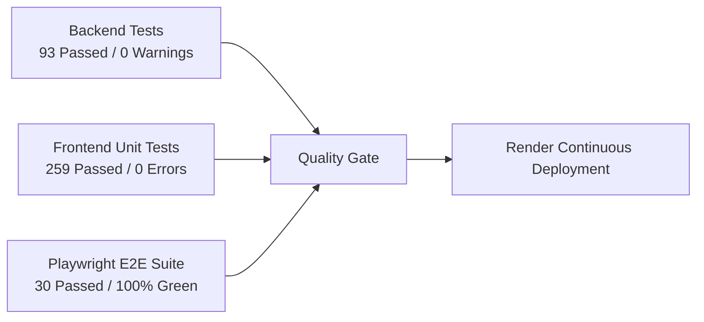
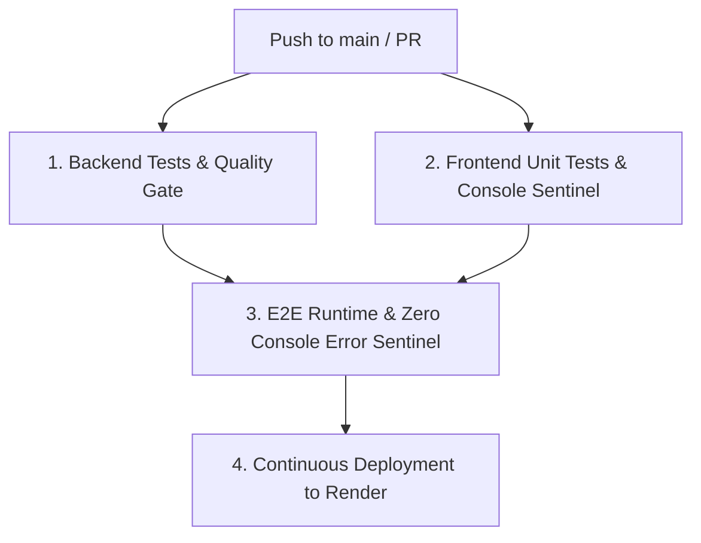

# ScrumPulse

ScrumPulse is an engineering telemetry and sprint tracking application for scrum teams and delivery leads. It tracks work item cycle times across micro-stages, pull request review turnaround, blocker SLAs, daily standups, and squad capacity to produce delivery metrics and sprint health reports.

---

## Table of Contents

- [Core Capabilities & 13 Feature Modules](#core-capabilities--13-feature-modules)
- [Technology Stack](#technology-stack)
- [System Architecture](#system-architecture)
- [Project Structure](#project-structure)
- [Security Architecture & Role-Based Access Control (RBAC)](#security-architecture--role-based-access-control-rbac)
- [Getting Started](#getting-started)
- [Prerequisites](#prerequisites)
- [Backend Setup](#backend-setup)
- [Frontend Setup](#frontend-setup)
- [Configuration & Environment Variables](#configuration--environment-variables)
- [Testing Architecture (3-Tier Matrix)](#testing-architecture-3-tier-matrix)
- [Backend Tests (.NET 10 / xUnit)](#backend-tests-net-10--xunit)
- [Frontend Unit Tests (Angular 22 / Karma)](#frontend-unit-tests-angular-22--karma)
- [End-to-End Test Suite (Playwright)](#end-to-end-test-suite-playwright)
- [CI/CD Pipeline Architecture](#cicd-pipeline-architecture)
- [Production Deployment & Docker](#production-deployment--docker)
- [API Overview](#api-overview)

---

## Core Capabilities & 13 Feature Modules

ScrumPulse provides 13 dedicated feature tabs plus multi-squad navigation:

| Tab # | Feature Module | Core Capabilities & Governance | E2E Spec |
| :---: | :--- | :--- | :--- |
| **1** | **Daily Standup & Timer** | Asynchronous 3-question submissions (Yesterday, Today, Blockers), mood indexing (1-5), and a 2-minute round-robin speaker clock with start/pause/reset controls. | `standup-crud-timer.spec.ts` |
| **2** | **Work Items & Lifecycle** | 7-stage micro-pipeline (`Backlog` -> `InProgress` -> `PrCreated` -> `PrApproved` -> `Merged` -> `InQa` -> `Done`) with DoR/DoD quality gate checklists and automatic latency telemetry. | `work-items-crud.spec.ts`, `advanced-workflows-edge-cases.spec.ts` |
| **3** | **Git PRs & Code Review** | Pull request review logs, actionable vs. total review comment ratios, turnaround metrics, and individual developer scorecards. | `pr-metrics.spec.ts` |
| **4** | **Blocker SLA Radar** | Real-time waiting-time counters, root-cause categorization (`ClientClarification`, `TechLeadArchitecture`, `EnvironmentAccess`, `ThirdPartyApi`), and SLA breach alert radar (>8 hours). | `blockers-crud.spec.ts`, `advanced-workflows-edge-cases.spec.ts` |
| **5** | **Leave & Capacity** | Multi-member leave calendar supporting full-day and half-day bookings; working-day math recalculates net squad focus hours and recommended story point commitments. | `team-capacity-crud.spec.ts` |
| **6** | **Team Roster** | Squad member directory with role assignments (`ScrumMaster`, `Developer`, `QaEngineer`, `Cdl`, `ProductOwner`, `ClientStakeholder`, `AgileCoach`), avatar selection, and active WIP limit governance. | `team-capacity-crud.spec.ts` |
| **7** | **Monthly 1:1 Reviews** | 360-degree feedback capturing SM guidance, CDL coaching, Client inputs, and self-reflection alongside happiness dials and rating metrics. | `monthly-reviews-crud.spec.ts` |
| **8** | **Retrospective Board** | 4-column retrospective board (`Went Well`, `Didn't Go Well`, `Ideas`, `Action Items`) with anonymous card posting, peer upvoting, and tracked action item checklists. | `kudos-retro-crud.spec.ts` |
| **9** | **Appreciation Wall** | Peer recognition cards with custom appreciation badges (`ProblemSolver`, `TeamPlayer`, `GoalCrusher`, `QualityGuardian`, `InnovationStar`, `ClientShoutout`) and live emoji reaction counters. | `kudos-retro-crud.spec.ts` |
| **10** | **Team Growth & Performance** | Multi-sprint delivery maturity telemetry, say-do predictability ratios, defect leakage reduction tracking, and automated performance letter grade badges (`A+`, `A`, `B+`, etc.). | `team-performance.spec.ts` |
| **11** | **Tech Hub (Debt & Talks)** | Dedicated technical debt inventory with severity levels and payoff sprint targets, plus an engineering tech talk log with slides and key takeaways. | `tech-hub-crud.spec.ts` |
| **12** | **AI Delivery Coach** | Built on the Microsoft Agent Framework over Groq and Gemini. Provides member coaching, sprint risk analysis, and a tool-calling copilot that queries live sprint data. Falls back to a rule-based analysis when the free-tier quota is spent. | `ai-coach.spec.ts` |
| **13** | **Executive Suite & Export** | Composite 6-dimension Sprint Health Score, custom duration filters (7, 14, 30, 90 days), and multi-format data export (CSV, JSON, and PDF). | `executive-export.spec.ts` |
| **Nav** | **Multi-Squad & RBAC Hub** | Multi-squad switcher with tenant isolation (`TeamId`), squad creation, join code management, and Scrum Master PIN security boundary. | `squad-management.spec.ts`, `scrum-master-pin.spec.ts` |

---

## Technology Stack

| Layer | Technology | Details |
|---|---|---|
| **Backend** | .NET 10 (C# 14) | ASP.NET Core Web API, Clean Architecture |
| **ORM** | Entity Framework Core 10 | PostgreSQL provider (production), SQLite provider (development), InMemory (testing) |
| **Frontend** | Angular 22 (Node 22) | Standalone components, signals, NgRx store & effects, vanilla responsive CSS |
| **AI Integration** | Microsoft Agent Framework 1.22 | `ChatClientAgent` over OpenAI-compatible endpoints (Groq primary, Gemini failover), function-calling retrieval, response evaluation |
| **Testing** | xUnit, Moq, Karma, Playwright | 93 backend tests, 259 frontend unit tests, 30 E2E tests |
| **Containerization** | Docker | Multi-stage build (Alpine Node 22 + .NET 10 SDK + ASP.NET runtime) |
| **Deployment** | Render.com | Web Service blueprint with automated GitHub Actions continuous deployment |

---

## System Architecture

The solution follows Clean Architecture principles:

```
ScrumPulse.Domain
 └── Entities, Enums, Value Objects, Domain Events, BaseEntity

ScrumPulse.Application
 └── Request/Response DTOs, CQRS Handlers, Sagas, Interfaces, Mapping

ScrumPulse.Infrastructure
 └── EF Core AppDbContext, Repositories, Migrations, Seed Data, Services

ScrumPulse.AI
 └── Agent provider & failover, retrieval tools, prompt/token budgeting, evaluation, rule-based fallback

ScrumPulse.Api
 └── ASP.NET Core Controllers, Rate Limiting, Compression, Swagger, SPA Host

ScrumPulse.UI
 └── Angular 22 Standalone Application (served via API wwwroot in production)
```

---

## Security Architecture & Role-Based Access Control (RBAC)

The application implements the following security controls:

### 1. Role-Based Access Control (RBAC) & PIN Security
- **Developer Role (Default)**: Team members can submit daily standups, log PR reviews, create work items, post kudos, and participate in retrospectives.
- **Scrum Master Role (Privileged)**: Modifying sprint goals/dates, deleting work items, removing roster members, approving leaves, and creating new squads are restricted to authenticated Scrum Masters.
- **Session tokens, not headers**: Joining a squad with its join code returns a signed, 12-hour session token in an `HttpOnly`, `SameSite=Strict` cookie. Team and role are read from that token only. Request headers such as `X-Team-Id` and `X-User-Role` are ignored.
- **PIN elevation**: Switching to Scrum Master requires the `SM_PIN`, checked in constant time against an existing session, and re-issues the token with the elevated role. Rate-limited to 5 attempts per minute per IP.
- **Secure by default**: A fallback authorization policy requires a session on every controller endpoint. Adding a new controller cannot accidentally expose squad data; anonymous access must be opted into with `[AllowAnonymous]`.
- **Tenant isolation in the data layer**: A global EF Core query filter scopes every entity to the session's team, and insert stamping forces team ownership from the session rather than the request body. A forgotten `Where` clause is no longer a data breach.

### 2. OWASP Security Headers
Configured via `SecurityHeadersMiddleware` on every response:
- **`Content-Security-Policy`**: Strictly whitelists trusted script, frame, and font sources; enforces `frame-ancestors 'none'`.
- **`X-Frame-Options: DENY`**: Prevents clickjacking and unauthorized embedding.
- **`X-Content-Type-Options: nosniff`**: Prevents MIME-confusion attacks.
- **`X-XSS-Protection: 1; mode=block`**: Activates browser reflective XSS filtering.
- **`Strict-Transport-Security: max-age=31536000; includeSubDomains`**: Enforces HTTPS (HSTS).
- **`Permissions-Policy: camera=(), microphone=(), geolocation=()`**: Blocks unauthorized hardware sensor access.

### 3. Rate Limiting
- **Global Sliding Window**: 60 requests per minute per IP.
- **Auth Endpoint Fixed Window**: 5 attempts per minute to block brute-force attempts.
- **AI Token Bucket**: Bounded rate limiting for generative AI coaching queries.

### 4. Injection & Vulnerability Safeguards
- **SQL Injection**: 100% Entity Framework Core parameterized LINQ queries.
- **XSS Sanitization**: Angular built-in contextual DOM escaping plus DOMPurify for HTML/markdown rendering.
- **Dependency Vulnerability Scanning**: Continuous verification via `dotnet list package --vulnerable --include-transitive` (0 vulnerable packages).
- **Security Policy & Vulnerability Disclosure**: Detailed reporting procedures and SLA guidelines documented in [.github/SECURITY.md](.github/SECURITY.md).

---

## Project Structure

```
c:\ScrumPulse/
├── ScrumPulse.slnx # .NET solution file (modern XML format)
├── Dockerfile # Multi-stage production container build
├── render.yaml # Render.com deployment blueprint
├── src/
│ ├── ScrumPulse.Domain/ # Core domain models, enums, domain events
│ ├── ScrumPulse.Application/ # Use cases, interfaces, DTOs, CQRS, sagas
│ ├── ScrumPulse.Infrastructure/ # Persistence, AppDbContext, Seed Data
│ ├── ScrumPulse.AI/ # Microsoft Agent Framework: agents, retrieval, evaluation
│ ├── ScrumPulse.Api/ # Web API host, middleware, controllers, wwwroot
│ └── ScrumPulse.UI/ # Angular 22 frontend
│ ├── e2e/ # Playwright end-to-end test suites (30 tests)
│ └── src/app/
│ ├── core/ # State (NgRx), services, models, components
│ └── features/ # Standup, Sprint Board, Blockers, Capacity, etc.
└── tests/
 └── ScrumPulse.Tests/ # Unit, integration, architecture, controller tests (93 tests)
```

---

---

## How the AI Works

The coach is built on the **Microsoft Agent Framework** (`Microsoft.Agents.AI`), running against
OpenAI-compatible inference endpoints so that a single `IChatClient` reaches either provider.

**Provider chain.** Groq serves first because its free tier answers fast enough to be useful during
a live ceremony; Gemini is failover because its daily allowance is larger. Either can be removed by
deleting its API key — no code change. With neither key set, the application still runs.

**Retrieval.** Insight endpoints aggregate the squad's metrics in SQL and put them to the agent as a
grounded prompt. The copilot instead receives *tools* (`get_active_sprint_status`,
`get_open_blockers`, `get_member_delivery_metrics`, `get_delivery_trends`) and fetches what it needs
itself. Both paths read through the same tenant-filtered retriever, so the assistant cannot reach
another squad's data — there is no parameter through which a team could be named. All tools are
read-only, so a prompt-injected instruction in a blocker title cannot make the agent write anything.

**Staying within free-tier quota.** Three mechanisms, in order of impact:

1. **Response caching** — insights are cached for an hour. Sprint metrics move slowly, so this turns
   one model call per page view into roughly one per hour per squad.
2. **Token budgeting** — prompts are estimated and trimmed on line boundaries, with 15% reserved as
   headroom. The estimate is deliberately conservative because the two providers tokenise
   differently and neither exposes its tokeniser.
3. **A daily request budget** — calls are counted locally and a circuit opens before the provider
   starts returning 429s, so the page does not wait on a round trip to learn there is no answer.

**Evaluation and honest degradation.** Generated responses are scored for data coverage,
actionability, risk calibration, and completeness. Anything below the configured bar is discarded —
a confident-sounding but ungrounded answer is worse than no answer. Whenever generation is skipped,
fails, or scores too low, a deterministic rule-based analysis is served instead. It restates the
real metrics: less insightful, always available, and incapable of inventing a figure. The service
logs which path produced every response, and rule-based output is never labelled as AI-generated.

### AI Standup Scribe

The Scrum Master can capture a standup live from a Teams call. The browser records the meeting
audio, Groq's Whisper transcribes it, and the agent attributes what was said to people on the
roster. Each draft carries a confidence score so the least certain attributions sort to the top
for review.

**Why it captures system audio rather than the microphone.** The obvious implementation — the
browser's `SpeechRecognition` API — does not work for this. It listens to the microphone, so
during a call it hears only the local speaker: remote voices arrive as *speaker output*, and
Teams' echo cancellation exists specifically to strip speaker output back out of the microphone
signal. On headphones it hears nothing of the call at all. Speech recognition also stalls in a
background tab, which is exactly where this runs while the Scrum Master is looking at Teams.

`getDisplayMedia({ audio: true })` captures the meeting itself. The video track is discarded
the moment the stream arrives and only audio is recorded, and `MediaRecorder` keeps running in a
background tab.

One platform detail drives the UI copy: in Chrome and Edge the share picker's three options do
not behave alike. **Entire Screen** offers "Also share system audio" (Windows and ChromeOS only),
and a **Tab** offers "Also share tab audio" — but **Window** cannot capture audio on any
platform. Sharing the Teams desktop app as a window therefore records video and silence, so the
dialog tells the user to pick Entire Screen, and the service detects a missing audio track and
says exactly how to fix it rather than just reporting failure. On macOS, system audio is
unavailable and Teams has to be running in a browser tab.

Two sources are mixed into the recording. System audio carries the remote participants, but
the local speaker's voice leaves through the microphone and never reaches the output stream, so
system audio alone would silently drop the Scrum Master's own update. A Web Audio graph combines
both into a single track — `MediaRecorder` encodes only the first audio track it is handed, so
adding two tracks to one stream would not work. Microphone access is best-effort: if it is
declined the capture continues without it and the dialog says so, rather than producing a
short transcript with no explanation.

Audio is recorded in 30-second chunks, each posted to `/api/standup-scribe/transcribe` as it
completes. That length is chosen against Groq's Whisper free tier — roughly 20 requests/minute
and 8 hours of audio/day — so a standup costs about two requests per minute, and the transcript
builds up during the ceremony instead of arriving in one upload at the end. A failed chunk costs
a few seconds, not the whole standup.

Four deliberate constraints:

- **Consent is gated in the UI.** The dialog cannot start capturing until the Scrum Master
  confirms the squad has been told, and a recording indicator stays visible throughout.
- **Audio is never stored.** Chunks are transcribed in-flight and discarded. Neither the audio
  nor the transcript is written to disk or to the logs.
- **Nothing is saved automatically.** The endpoint returns drafts. They go through the same
  validated submit path as a typed standup.
- **Speakers are matched against the roster, never invented.** A misheard name surfaces as an
  unmatched speaker rather than being attached to the wrong person's record.

Browsers without `getDisplayMedia` (and any tenant that blocks audio capture) fall back to
pasting a transcript — including one exported from Teams live transcription, which carries
speaker labels and so gives noticeably better attribution than Whisper alone.


## Getting Started

### Prerequisites

- [.NET 10 SDK](https://dotnet.microsoft.com/download/dotnet/10.0)
- [Node.js 22+](https://nodejs.org/) and npm

### Backend Setup

1. Restore dependencies and build the solution:
 ```bash
 dotnet build ScrumPulse.slnx
 ```

2. Run the API project:
 ```bash
 dotnet run --project src/ScrumPulse.Api
 ```

3. The API will start on:
- HTTP: `http://localhost:5000`
- HTTPS: `https://localhost:5001`
- Interactive Swagger docs: `http://localhost:5000/swagger`

> **Note on Initial Run:** By default, the app uses SQLite (`ScrumPulse.db`). On first boot, `DbInitializer` automatically creates the schema and seeds multi-sprint demonstration data so the platform is immediately functional.

### Frontend Setup

1. Navigate to the UI project directory:
 ```bash
 cd src/ScrumPulse.UI
 ```

2. Install npm packages:
 ```bash
 npm install --legacy-peer-deps
 ```

3. Start the Angular development server:
 ```bash
 npm start
 ```

4. Open `http://localhost:4200` in your browser.

---

## Configuration & Environment Variables

| Key / Environment Variable | Default | Description |
|---|---|---|
| `DatabaseProvider` | `Sqlite` | Database provider: `Sqlite` or `PostgreSql`. |
| `ConnectionStrings__DefaultConnection` / `DATABASE_URL` | `Data Source=ScrumPulse.db` | ADO.NET connection string or standard PostgreSQL connection URI (`postgres://...`). |
| `Auth__ScrumMasterPin` / `SM_PIN` | `""` (disabled) | PIN that elevates a squad session to Scrum Master. |
| `SESSION_SIGNING_KEY` | none | **Required outside Development.** Minimum 32 characters, used to sign session tokens. Startup fails without it. Generate with `openssl rand -base64 48`. |
| `GROQ_API_KEY` | none | Groq API key. Primary AI provider. Without it the coach serves its rule-based analysis. |
| `GEMINI_API_KEY` | none | Gemini API key. Used as failover when Groq is unavailable or its daily allowance is spent. |
| `ASPNETCORE_ENVIRONMENT` | `Development` | Environment: `Development` or `Production`. |
| `PORT` | `8080` (container) | Port for the web server to bind to in production. |
| `SeedDemoData` | `false` | When true, forces seeding of demonstration records. |

---

## Testing Architecture (3-Tier Matrix)

ScrumPulse enforces quality across three automated testing tiers:



### Backend Tests (.NET 10 / xUnit)
```bash
# Run all 93 backend tests with strict zero-warning enforcement
dotnet test ScrumPulse.slnx -c Release
```
- **Scope**: `TeamPerformanceServiceTests`, extended domain entities (`Monthly1on1Feedback`, `PullRequestReviewLog`, `DailyStandup`, `TechDebtItem`, `TechTalkLog`, `RetroCard`, `RetroActionItem`, `KudosCard`, `Team`), and full CRUD controllers (`TechHubController`, `MonthlyFeedbackController`, `SprintsController`, `TeamMembersController`).
- **Result**: **93 passed, 0 failed, 0 warnings** under `/warnaserror`.

### Frontend Unit Tests (Angular 22 / Karma)
```bash
cd src/ScrumPulse.UI
npm run test:ci
```
- **Scope**: Components, services, reducers, and NgRx Effects (`blockers.effects.spec.ts`, `pull-requests.effects.spec.ts`, `work-items.effects.spec.ts`).
- **Result**: **259 passed, 0 failed**.

### End-to-End Test Suite (Playwright)
```bash
cd src/ScrumPulse.UI
npx playwright test
```
- **Scope**: 30 end-to-end tests covering every tab, input validation boundaries, state progression pipelines, cancel safeguards, and the zero-console-error sentinel.
- **Result**: **30 passed, 0 failed**.

---

## CI/CD Pipeline Architecture

The GitHub Actions workflow (`.github/workflows/ci.yml`) runs 4 automated jobs on every push and pull request:



1. **Backend Tests & Quality Gate**:
- Compiles solution with strict `/warnaserror`.
- Executes all 93 backend unit and integration tests.
- Verifies zero vulnerable NuGet packages via `dotnet list package --vulnerable --include-transitive`.
2. **Frontend Unit Tests & Console Sentinel**:
- Compiles Angular application bundle.
- Executes all 259 Jasmine/Karma unit tests.
3. **E2E Runtime & Zero Console Error Sentinel**:
- Boots the .NET 10 API with the compiled Angular SPA.
- Executes all 30 Playwright tests on headless Chromium.
- Asserts zero console errors or warnings across all views.
4. **Continuous Deployment to Render (Free)**:
- Triggers production deploy hook to rollout changes to `https://scrumpulse.onrender.com`.

---

## Production Deployment & Docker

### Multi-Stage Dockerfile

```bash
# Build container image
docker build -t scrumpulse:latest .

# Run container with SQLite
docker run -p 8080:8080 -e DatabaseProvider=Sqlite scrumpulse:latest

# Open http://localhost:8080
```

### Live Production
- **Production Host**: [https://scrumpulse.onrender.com](https://scrumpulse.onrender.com)
- **Health Check Probe**: `GET https://scrumpulse.onrender.com/healthz` (`HTTP 200 Healthy`)
- **Google AdSense Verification**: Official script active in `<head>` ready for crawler review.

---

## API Overview

All API endpoints follow RESTful conventions under the `/api/` prefix with Swagger documentation at `/swagger`:

| Endpoint | Methods | Description |
|---|---|---|
| `/api/work-items` | `GET`, `POST`, `PUT`, `DELETE` | Work item management with CQRS and micro-stage advancement |
| `/api/work-items/{id}/advance-stage` | `POST` | Advances work item to next stage (triggers completion saga on Done) |
| `/api/blockers` | `GET`, `POST`, `PUT`, `DELETE` | Blocker management with root-cause category and SLA tracking |
| `/api/blockers/{id}/resolve` | `POST` | Marks blocker as resolved with resolution audit notes |
| `/api/sprints` | `GET`, `POST`, `PUT`, `DELETE` | Sprint lifecycle, activation, and capacity targets |
| `/api/leaves` | `GET`, `POST`, `PUT`, `DELETE` | Leave requests and member capacity calculation |
| `/api/leaves/capacity/{sprintId}` | `GET` | Computes net sprint capacity factoring in approved leaves |
| `/api/standups` | `GET`, `POST`, `PUT`, `DELETE` | Asynchronous standup submissions and squad history |
| `/api/team-performance/summary` | `GET` | Multi-sprint growth trends, delivery highlights, and velocity |
| `/api/executive-reports/sprint/{id}/health` | `GET` | 6-dimension sprint health composite radar |
| `/api/monthly-feedback` | `GET`, `POST`, `PUT`, `DELETE` | 360-degree monthly review records with ratings and AI synthesis |
| `/api/retrospectives` | `GET`, `POST`, `DELETE` | Retrospective cards, upvoting, and action items |
| `/api/kudos` | `GET`, `POST` | Peer recognition cards and emoji reactions |
| `/api/pull-requests` | `GET`, `POST`, `DELETE` | PR turnaround metrics and review comment analysis |
| `/api/tech-hub` | `GET`, `POST`, `DELETE` | Tech debt inventory and engineering tech talk logs |
| `/api/teams` | `GET`, `POST`, `PUT` | Multi-squad management and join code verification |
| `/api/ai-coach/chat` | `POST` | Conversational coaching. The agent calls retrieval tools to fetch live sprint data before answering |
| `/api/standup-scribe/draft` | `POST` | Splits a standup transcript into per-member draft updates for review. Scrum Master only |
| `/healthz` | `GET` | Automated health check probe |

---

## Author & Maintainer

ScrumPulse is developed and maintained by **[Ranjitha Savandaiah](https://github.com/RanjithaSavandaiah)** ([LinkedIn](https://www.linkedin.com/in/ranjitha-savandaiah)).
